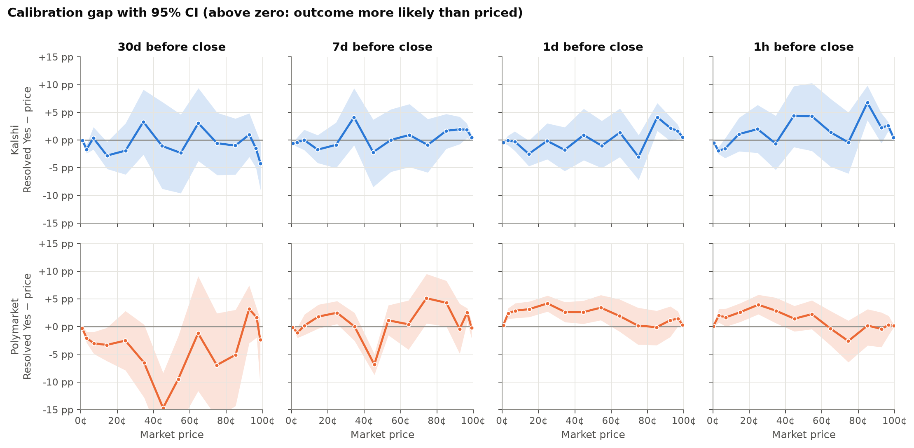
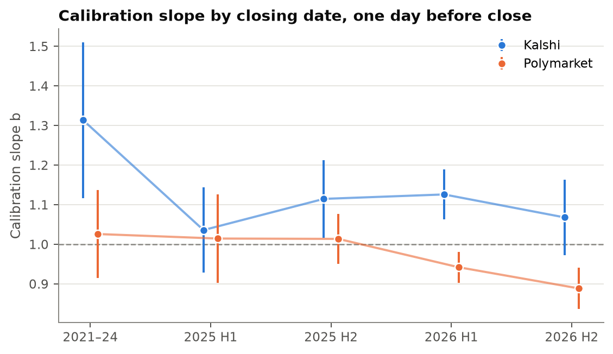
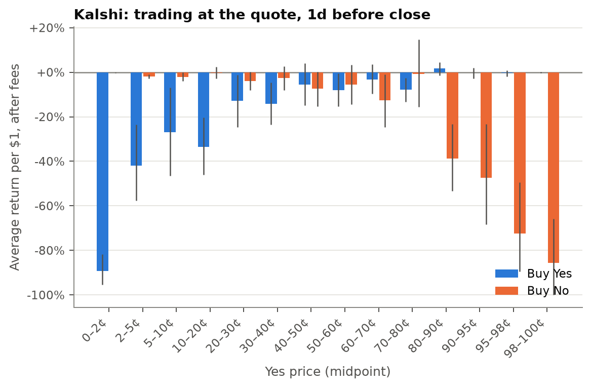
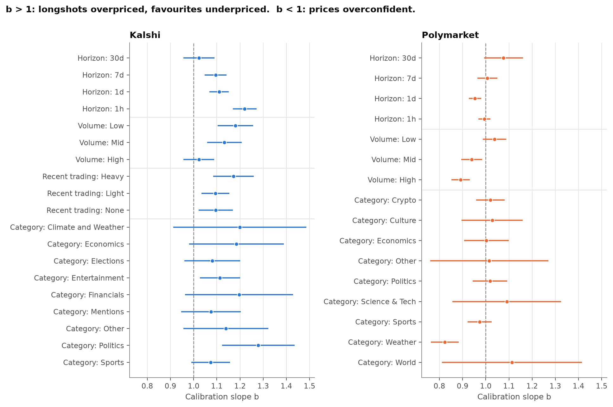

# Are prediction markets calibrated?

[](https://github.com/hrishi-tailor/prediction-market-calibration/actions/workflows/ci.yml)

When a prediction market prices an outcome at 70¢, does it happen 70% of the time?

**[Explore the interactive results →](https://hrishitailor.com/prediction-markets/)**

This project tests that on **46,168 resolved markets** from Kalshi and Polymarket
(118,093 price observations, 2021–2026). It measures each market's price at fixed
horizons before close, compares it with what actually happened, tests for the
favourite–longshot bias, tracks it over time, and asks whether any mispricing survives
trading costs or can be used to forecast better than the market.

## Findings

1. **On average, yes, to within 1–2 percentage points.** Across all price buckets,
   realized frequencies sit within about 1pp of Kalshi prices and 1–3pp of
   Polymarket prices (expected calibration error).
2. **Kalshi has a favourite–longshot bias, and it grows as close approaches.** The
   calibration slope (1 = perfectly calibrated, above 1 = longshots overpriced) rises
   from 1.02 thirty days out to **1.11 one day out and 1.22 one hour out**. Part of
   that is Kalshi's 1¢ tick floor at the extremes, but the bias survives with the
   tails excluded (1.08 at one day, 95% CI 1.02–1.14).
3. **The bias lives in less popular markets, not in quiet moments.** Kalshi's
   least-traded third of markets (by lifetime volume) has a slope of 1.18; the
   most-traded third is calibrated (1.02). Politics is the most biased category
   (1.28). But split by trading in the 24 hours before each price, the bias is about
   the same with no trades, light trading or heavy trading (1.10, 1.09, 1.17). It
   belongs to the kind of market, not to a lull in activity.
4. **Kalshi's bias has been smaller since its growth took off, but persists.** By
   closing date, the one-day slope was 1.31 for markets before 2025 (95% CI
   1.12–1.51) and 1.04–1.13 in each half-year since.
5. **Polymarket's apparent decline in 2026 is a change in what it lists.** Its
   one-day slope fell from 1.02 before 2026 to 0.92 in 2026 (overconfident). Over
   the same period weather markets rose from 5% to 29% of its listings, and they
   are the overconfident category (0.82). Excluding them, 2026 is 0.99: no change.
6. **None of it is a free lunch.** Buying Kalshi longshots at the ask loses heavily:
   **−89% per dollar for 0–2¢ contracts**, −34% at 10–20¢. Buying favourites or fading
   longshots loses only 0–2% after the spread and taker fee. No price bucket earns a
   significantly positive return.
7. **Nor is it a forecasting edge.** A calibration correction learned on markets that
   closed before July 2025 and applied to the 36,097 later one-day prices does not
   beat the market's own odds: Kalshi's Brier score changes by +0.02% (95% CI −0.24%
   to +0.25%), and Polymarket's gets slightly worse. A bias you can measure after the
   fact isn't one you can use.



Each point is a price bucket: how much more often the outcome happened than the
price implied. Shaded bands are 95% confidence intervals, clustered by event.







More figures: [reliability diagrams by horizon](figures/reliability_by_horizon.png),
[Kalshi vs Polymarket](figures/platform_comparison.png). Every number above comes from
[`reports/results.md`](reports/results.md), which the pipeline regenerates.

## How it works

The key design decisions, each explained in [`docs/methodology.md`](docs/methodology.md):

- **Prices at fixed horizons, not final prices.** By the time a market closes the
  outcome is usually known, so final prices are near 0 or 1 and trivially
  "calibrated". Each market is priced 30 days, 7 days, 1 day and 1 hour before it
  closed, using only data from before that moment.
- **Bid/ask midpoints on Kalshi,** with spreads over 10¢ dropped; hourly price history
  on Polymarket.
- **Sampling caps,** so Kalshi's hourly temperature and index series (thousands of
  near-identical markets) don't drown out everything else: at most 10 markets per
  series or event, chosen with a fixed seed.
- **Event-clustered uncertainty.** Markets in the same event resolve together (one
  bracket of a CPI print wins), so every interval comes from a bootstrap or
  standard errors that treat the event, not the market, as the unit.
- **A logistic calibration regression,** `P(yes) = sigmoid(a + b·logit(price))`, to
  test the favourite–longshot bias: b > 1 means longshots are overpriced. The slope
  doesn't depend on which side of a market is labelled "Yes".
- **Three traps checked explicitly:**
  - *Tick size:* Kalshi can't price a near-certain outcome above about 98.5¢, which
    alone mimics the bias. Slopes are refitted on 5–95¢ prices.
  - *Stopping time:* "Will X happen by D?" markets close when X happens, so their
    close time depends on their outcome. 10% of Polymarket markets closed early;
    results are reported with and without them.
  - *Cost of capital:* discounting locked-up money also pulls prices toward 50¢, but
    by at most 0.21¢ at 30 days, far too little to explain the bias.

## Data

| | Kalshi | Polymarket |
|---|---|---|
| Markets | 16,533 | 29,635 |
| Events | 9,070 | 20,522 |
| Observations | 44,225 | 73,868 |
| Closing dates | Jul 2021 – Aug 2026 | Dec 2022 – Oct 2026 |
| Source | [Trade API v2](https://docs.kalshi.com) (public market data) | Gamma + CLOB public APIs |

Both APIs are public and need no key. Kalshi markets with at least 1,000 contracts
traded and Polymarket markets with at least $10,000 traded are eligible; from those,
25,000 Kalshi and 30,000 Polymarket markets were sampled. Some sampled markets
contribute no observations because they were open for less than an hour or never
had a quote within 10¢.

## Reproduce

Requires Python 3.12 and [uv](https://docs.astral.sh/uv/).

The quickest route uses the dataset attached to the
[v1.1.0 release](https://github.com/hrishi-tailor/prediction-market-calibration/releases/tag/v1.1.0):

```bash
uv sync
gh release download v1.1.0 -p observations.parquet -D data
make analyze            # figures/ and reports/, in about a minute
```

To rebuild everything from the APIs:

```bash
uv sync
make fetch-kalshi       # ~3 hours: rate-limited to 4 requests/second
make fetch-polymarket   # ~4 hours
make build              # data/observations.parquet
make analyze            # figures/ and reports/
```

Fetching is resumable: raw responses are cached under `data/raw/` and never
re-downloaded, so an interrupted run picks up where it stopped. Sampling is
seeded, so a rerun selects the same markets, though new markets will have closed
since.

```bash
make test               # pytest
make lint               # ruff
```

## Website

The [project page](https://hrishitailor.com/prediction-markets/) is a
static site in `site/`, deployed to GitHub Pages on every push to `main` and served on
hrishitailor.com through a Vercel rewrite. It reads only
`site/data/results.json`, which `make analyze` writes alongside `reports/results.md`, so
the page always shows the latest run. To preview it locally:

```bash
python3 -m http.server --directory site
```

## Layout

```
src/pmcal/
  http.py         rate-limited client with retries
  kalshi.py       series discovery, sampling, hourly candles
  polymarket.py   event discovery, sampling, price history, close times
  dataset.py      per-horizon prices -> data/observations.parquet
  metrics.py      reliability tables, Brier decomposition, cluster bootstrap
  models.py       calibration regression, subgroup slopes, returns
  plots.py        figures
  report.py       runs everything, writes reports/results.md
  site_data.py    exports the website's numbers to site/data/results.json
site/             project website (HTML, CSS, D3)
tests/            unit tests on synthetic data with known answers
docs/             methodology
```

The tests check the statistics against simulations with known answers: the
regression recovers a planted slope, clustered intervals widen when outcomes are
shared within events, the Brier decomposition adds up, and no future quote leaks
into a horizon.

## Limitations

- Lifetime volume is measured after the fact. For Kalshi, the 24-hour trading measure
  shows what a trader could see at the time; Polymarket's history has no volume, so its
  volume split is lifetime-only.
- Polymarket's price history is a single price per point with no bid or ask, so
  Polymarket returns can't be computed honestly and aren't reported.
- Kalshi doesn't expose a scheduled close separate from the actual one, so the
  stopping-time check covers Polymarket only.
- Categories are each platform's own labels and don't map one-to-one across
  platforms; the two platforms also list very different mixes of markets, so their
  Brier scores aren't directly comparable.

## License

MIT
